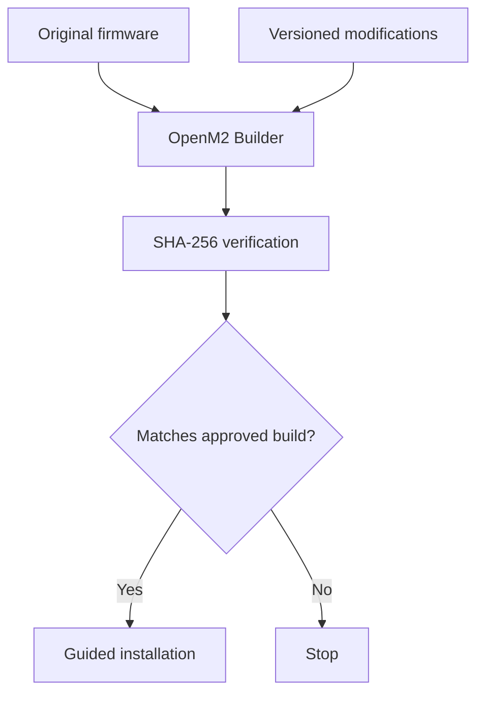

  

  <strong>Custom firmware. Advanced controls. A new editing experience.</strong> 
  An independent customization project for the Sonicake Matribox II (QME-100).

  
  
  

  <a href="#overview">Overview</a> ·
  <a href="#firmware">Firmware</a> ·
  <a href="#studio">Studio</a> ·
  <a href="#installer">Installer</a> ·
  <a href="#roadmap">Roadmap</a>

---

## Overview

**OpenM2** is an independent project exploring the potential of the Sonicake Matribox II through firmware research, embedded development and modern audio software design. Its goal is to give musicians more control over their existing hardware while preserving a reliable, intuitive workflow.

| Component | Purpose |
| :--- | :--- |
| **OpenM2 Firmware** | Enhanced interface, flexible effects and expanded performance controls. |
| **OpenM2 Studio** | A desktop editor for tones, scenes, controls and personalization. |
| **OpenM2 Installer** | Local firmware generation, verification, guided installation and recovery. |

## Firmware

The custom firmware is designed around a shared core:

- Redesigned graphical interface.
- Flexible FX block configurations and expanded effect choices.
- Six independent TAP/HOLD assignments.
- Configurable Preset, Stomp and Scene modes.
- Advanced scene management with up to six scenes per preset (under validation).
- Performance and usability improvements.

### Editions

| Edition | Block configuration | Status |
| :--- | :--- | :--- |
| Classic | FX1 + FX2 + AMP | Planned |
| Extended | FX1 + FX2 + FX3 | In development |
| Hybrid | FX1 + FX2 + interchangeable AMP/FX3 | Experimental concept |

Each edition is intended to offer two library profiles:

- **Stock:** compatible original algorithms.
- **Expanded:** additional compatible algorithms obtained locally from authorized sources where permitted.

Hybrid availability depends on technical validation.

## Studio

OpenM2 Studio is a desktop editor concept inspired by professional guitar software. Its interactive prototype explores a visual pedalboard with individual pedal artwork, a full-width parameter editor and integrated performance controls.

Planned capabilities include:

- Visual signal chain editing and effect selection.
- Preset organization, names, colors and scene management.
- Footswitch TAP/HOLD assignments, expression and quick knob configuration.
- IR and capture management, where supported.
- Appearance customization and a preview of the 480 × 272 device display.
- USB synchronization, device settings, backup and firmware management.

> The current interface prototype is offline; it does not yet control the physical device or process audio.

## Installer

OpenM2 Installer is intended to generate custom firmware on the user's computer from verified original firmware files, rather than redistribute proprietary firmware binaries.

The planned release process requires verified source files, reproducible generation, an approved output hash, hardware compatibility checks and manual hardware test approval for each released edition. Backups and recovery instructions are intended to be part of the installation workflow.

Matching hashes establish binary identity with a tested reference, not universal hardware safety. Only validated builds should be released as stable.

## Compatibility

| Device | Support |
| :--- | :--- |
| Sonicake Matribox II (QME-100) | Primary development target |
| Sonicake Matribox II Pro (QME-200) | Not supported |
| Other devices | Not supported |

## Roadmap

- [x] Initial firmware research and reverse engineering
- [x] Redesigned interface prototype and firmware modifications
- [x] Extended FX configuration and TAP/HOLD controls
- [x] Interactive desktop editor prototype
- [ ] Validate advanced Scene Mode on hardware
- [ ] Reproducible firmware generation and per-edition verification
- [ ] Classic and Extended release candidates
- [ ] Guided installer and recovery workflow
- [ ] Official editor compatibility validation
- [ ] OpenM2 Studio USB integration
- [ ] Appearance customization and additional scene metadata
- [ ] Investigate DSP monitoring and Hybrid architecture
- [ ] First stable public release

## Contributing

Feedback, firmware research, DSP development, interface design, documentation and hardware testing are welcome. Please report the exact hardware model, firmware edition and steps to reproduce any issue. Do not upload proprietary firmware or unauthorized third-party assets.

## License

The license for original OpenM2 components will be finalized before public distribution. Third-party components remain subject to their respective licenses. Local generation does not imply authorization to modify or redistribute third-party software.

## Disclaimer

OpenM2 is an independent, unofficial project. It is not affiliated with, sponsored by or endorsed by Sonicake or any other hardware manufacturer. Firmware modification may cause device malfunction, data loss or warranty implications. Experimental builds are not intended for production or live use until validated.

---

<strong>OpenM2</strong> — Beyond factory limits.

